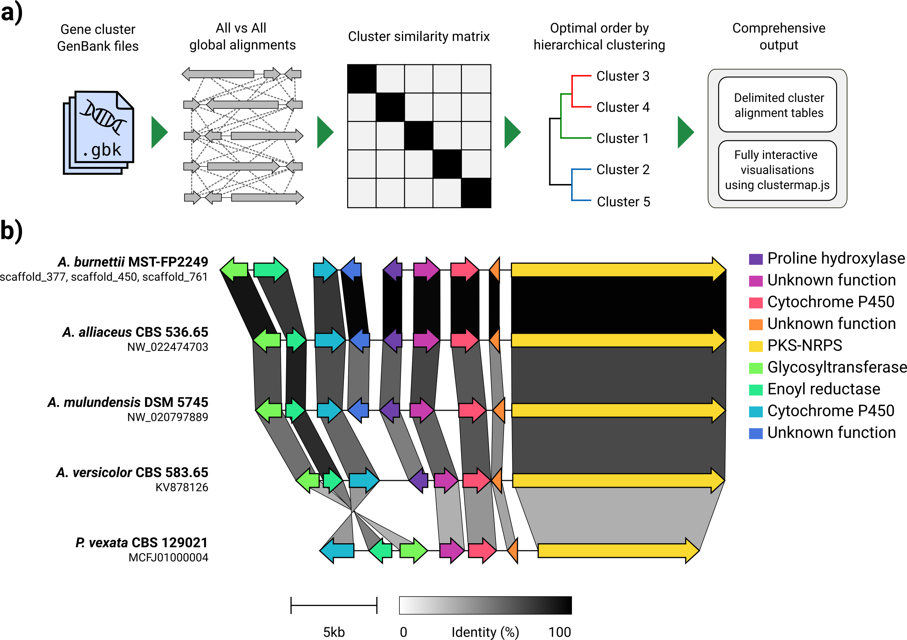

# clinker

Generate interactive gene cluster comparison figures from GenBank or GFF3/FASTA
files, inspect homology links, and export figures as SVG.



## Applications

- **Web app:** load files, compare clusters, add trees and annotations, and edit
  figures locally in your browser. Input file contents are not uploaded.
- **Native CLI:** run the same Rust analysis core from the command line and
  generate plot data or a portable HTML figure. See [CLI usage](docs/cli.md).

This branch contains the Rust implementation. The original Python package and
its PyPI releases are maintained on
[`python-maintenance`](https://github.com/gamcil/clinker/tree/python-maintenance).
See [Python maintenance releases](docs/python-maintenance.md) for that process.

## Build from source

Run from the repository root:

```sh
cargo build --locked --release -p clinker-cli
./target/release/clinker-rs examples/*.gbk --plot figure.html
```

The executable is currently named `clinker-rs`. Cargo builds use the committed
viewer assets and do not require Node.js, npm, or a web build.

For the browser application, install Node.js/npm, Rust with the
`wasm32-unknown-unknown` target, and `wasm-pack`, then run:

```sh
sh web/build.sh
sh web/package.sh /tmp/clinker-web
```

Serve the packaged directory over HTTP. See [web development](web/README.md)
and [deployment](web/DEPLOYMENT.md) for details.

## Repository layout

```text
Cargo.toml, Cargo.lock   shared Rust workspace
crates/clinker-core/    parsing, alignment, grouping and plot data
crates/clinker-cli/     native command line and bundled viewer assets
crates/clinker-wasm/    browser bindings to the shared core
web/                   browser app, workers and frontend checks
examples/              example inputs
bench/                 comparative analysis benchmarks
docs/                  architecture, CLI and release documentation
```

See [architecture and development](docs/architecture.md),
[feature status](docs/features.md), and [release procedure](docs/releasing.md).
The shared local viewer and Cargo release packaging are subsequent migration
steps; the current CLI still generates its existing portable HTML viewer.

## Citation

Gilchrist, C.L.M. and Chooi, Y.-H. (2021). *clinker & clustermap.js: Automatic
generation of gene cluster comparison figures.* Bioinformatics.
[doi:10.1093/bioinformatics/btab007](https://doi.org/10.1093/bioinformatics/btab007).
